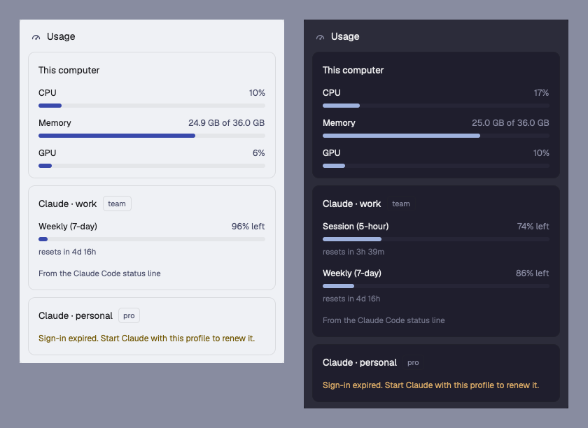

# Usage for Herdr

A Herdr mod that shows how busy your computer is (CPU, memory, GPU) and how much
of each Claude Code plan limit is left, for every Claude Code profile in your
home folder. It follows your Herdr theme, light or dark.



## Install

Ask the agent in Herdr to add this mod from the repo URL, or copy it yourself:

```sh
git clone https://github.com/akhilnalliboina/herdr-usage
cp -R herdr-usage/usage ~/.config/herdr-app/mods/usage
herdr-app check ~/.config/herdr-app/mods/usage
```

Open it with `herdr-app do mod.open '{"name":"usage"}'`, or add a button to your
tab bar mod that calls:

```js
openOverlay({ mod: "usage", kind: "popup", width: 380, height: 560, props: { popup: true } });
```

`RECIPE.md` describes the mod in full, including an optional status line snippet
that keeps the limits fresh when the usage endpoint is busy.

## What it reads

- Your Claude Code sign-in, from `~/.claude*/.credentials.json` or the macOS
  keychain. The token is sent only to `api.anthropic.com` and is never stored.
- CPU, memory and GPU through `top`, `vm_stat`, `sysctl` and `ioreg` on macOS,
  or `/proc` and `nvidia-smi` on Linux.

The usage endpoint is the one Claude Code itself uses. It is not a public API
and may change.

## License

MIT
