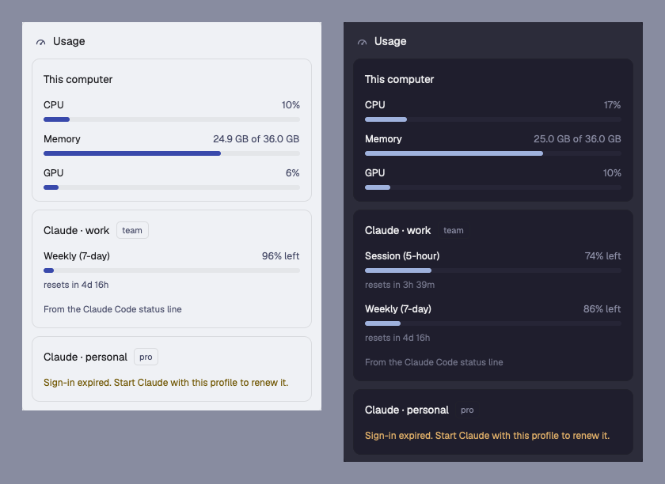

# Usage

A popup that shows how busy this computer is and how much of each Claude Code
plan limit is left. It has one card for the computer (CPU, memory, GPU) and one
card for each signed-in Claude Code profile in the home folder, with a bar per
limit and the time until it resets. It uses the theme's colours, so it looks
right in light and dark themes.



## What you see

- **Header**, 14 px semibold "Usage" with a gauge icon. A small spinner shows
  while the first numbers load.
- **This computer** card: CPU, Memory and GPU rows. Each row has the name on
  the left, the value on the right (`12%`, `27.9 GB of 36.0 GB`), and a 6 px
  bar under it. GPU shows a dash when the machine reports no GPU figure.
- **One card per Claude profile**, bigger plans first (enterprise, team, max,
  pro, free), and profiles with an error last, titled `Claude · <name>` with the plan as a
  badge (`team`, `pro`, `max`). One bar per limit: `Session (5-hour)`,
  `Weekly (7-day)`, and a model-scoped weekly limit when the plan has one
  (for example `Fable weekly`). The value reads `87% left`, with `resets in 3h 12m`
  under the bar.
- Bars use `accent`, turn `ansi3` (yellow) at 70% used and `ansi1` (red) at
  90% or when the API marks the limit as warning or critical.
- Cards use `surface` with a `border` frame and 10 px corners on the
  `popover` background. The popup is 380 px wide, as tall as its cards, and scrolls
  above 680 px of cards.

## How it behaves

- Opening the popup reads the computer every 4 s and the plan limits every
  5 minutes. Closing it stops both. Nothing runs while it is closed.
- When the endpoint fails (429, offline, expired), the card shows the limits a
  Claude Code status line wrote in the last 15 minutes, with the note "From the
  Claude Code status line".
- The last numbers are kept in shared state, so the popup opens with numbers
  at once and then updates.
- A profile with no sign-in is left out. An expired sign-in shows "Sign-in
  expired. Start Claude with this profile to renew it."
- When the endpoint answers 429, the card keeps its last numbers and adds
  "Not updated: too many requests".
- The mod also works as a layout block: it then draws a small button (gauge
  icon and the first account's session percent) that opens the popup.

## Built from

- `main.js`: one `View`. `props().overlay` decides the form: popup or button.
  `cx.timer.every` drives both refreshes inside `cx.spawn`.
- Profiles: `fs.readdir(home())`, every `.claude` and `.claude-<name>` folder.
  `~/.claude` is labelled `default`.
- Sign-in: `<profile>/.credentials.json` (Linux), else the macOS keychain item
  `Claude Code-credentials` for `~/.claude` and
  `Claude Code-credentials-<first 8 hex of sha256(folder path)>` for any other
  folder, read with `security find-generic-password -s <item> -w`.
  `sha256.js` computes the hash in plain JavaScript.
- Limits: `fetch("https://api.anthropic.com/api/oauth/usage")` with
  `Authorization: Bearer <accessToken>` and `anthropic-beta: oauth-2025-04-20`.
  It reads the `limits` list (`kind`, `percent`, `severity`, `resets_at`,
  `scope.model.display_name`) and falls back to `five_hour` / `seven_day`
  (`utilization`, `resets_at`).
- Status line feed (optional, recommended): add this after `input=$(cat)` in
  the status line script, so every Claude session hands its limits over for free:

  ```sh
  usage_file="${CLAUDE_CONFIG_DIR:-$HOME/.claude}/usage-limits.json"
  printf '%s' "$input" | jq -c 'select(.rate_limits) | {at: now, rate_limits}' >"$usage_file.$$" 2>/dev/null &&
    [ -s "$usage_file.$$" ] && mv "$usage_file.$$" "$usage_file" || rm -f "$usage_file.$$"
  ```

  The mod reads `<profile>/usage-limits.json`: `rate_limits.five_hour` and
  `seven_day`, each `used_percentage` and `resets_at` (epoch seconds).
- Computer: `stats.js` holds a shell script run with `exec("sh", ["-c", …])`.
  macOS: `top -l 2 -n 0 -s 1` (CPU), `vm_stat` + `hw.memsize` (memory counted
  like Activity Monitor: app + wired + compressed), `ioreg` "Device
  Utilization %" (GPU). Linux: `/proc/stat`, `/proc/meminfo`, `nvidia-smi`.
- Shipped icon used: `mods/workspace-chrome/spinner.svg`. Own icon: `gauge.svg`.
- To put a button on a tab bar mod:
  `openOverlay({ mod: "usage", kind: "popup", width: 380, height: 560 })`.

## Watch out

- A popup from `openOverlay` takes its height from its content and ignores
  `height`. A root with `size_full` and a body with `flex_1` collapses to the
  47 px header. The body uses `max_h(680)` and scrolls instead. A smaller cap that is
  close to the content height cuts the last card off at the bottom.
- Herdr's `fs` has no `stat`. A folder is a name that `fs.readdir` opens;
  calling `fs.stat` throws and stops the refresh.
- Never refresh an expired token from the mod. Claude Code rotates the refresh
  token on each refresh, so a refresh here signs that profile's Claude out.
- The usage endpoint answers 429 when polled often. Claude Code polls it too,
  so keep the interval at minutes, not seconds.
- `top` needs two samples: the first one counts from boot.
- The status line feed has only the session and weekly limits, not the
  model-scoped ones, and a limit drops out of it once its window has reset.
- Only percentages and names go into shared state. Tokens stay in the mod.
- The folder name is used in icon paths (`mods/usage/gauge.svg`); rename those
  when the folder is renamed.
- The endpoint is the one Claude Code uses. It is not a public API and its
  fields may change.

## Done when

- `herdr-app check mods/usage` passes.
- The popup shows CPU, memory and GPU within 2 s, and the numbers change
  every few seconds.
- Each signed-in profile shows its plan badge and at least the session and
  weekly bars with reset times; values match `/usage` in Claude Code.
- An expired profile shows the renew message; an unused `~/.claude` folder
  does not show.
- Switching between a light and a dark theme recolours the popup at once.
